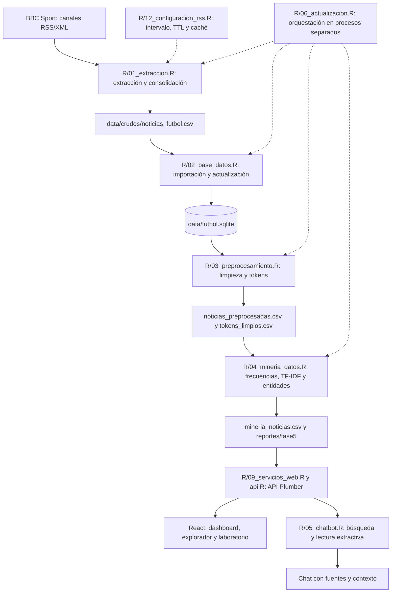

# FootDataAI

**Observatorio de noticias de fútbol con extracción automatizada desde RSS, minería de texto, visualizaciones interactivas y un chatbot local con contexto de conversación.**

FootDataAI transforma titulares y resúmenes de BBC Sport en un conjunto de datos que puede almacenarse, depurarse, analizarse y consultarse desde una interfaz web. Integra un flujo de procesamiento en **R**, almacenamiento en **SQLite**, una **API Plumber** y una aplicación **React con TypeScript**.

El proyecto tiene un enfoque académico de minería de datos: permite seguir cómo una noticia pasa de una fuente web a un registro estructurado, después a tokens y entidades, y finalmente a indicadores, gráficos y respuestas respaldadas por el texto disponible.

> **Alcance de la implementación:** la fuente actual es RSS/XML de BBC Sport; no se descarga el cuerpo completo de los artículos. El chatbot utiliza reglas, búsqueda y lectura extractiva de resúmenes. No utiliza modelos de lenguaje, traducción automática, embeddings ni servicios externos de inteligencia artificial.

## Contenido

1. [Propósito y objetivos](#1-propósito-y-objetivos)
2. [Funcionalidades del sistema](#2-funcionalidades-del-sistema)
3. [Arquitectura y recorrido de los datos](#3-arquitectura-y-recorrido-de-los-datos)
4. [Tecnologías y responsabilidades](#4-tecnologías-y-responsabilidades)
5. [Estructura del repositorio](#5-estructura-del-repositorio)
6. [Fuente de información y extracción web](#6-fuente-de-información-y-extracción-web)
7. [Almacenamiento y modelo de datos](#7-almacenamiento-y-modelo-de-datos)
8. [Preprocesamiento y calidad](#8-preprocesamiento-y-calidad)
9. [Minería de texto y detección de entidades](#9-minería-de-texto-y-detección-de-entidades)
10. [Visualizaciones e interpretación](#10-visualizaciones-e-interpretación)
11. [Funcionamiento del chatbot](#11-funcionamiento-del-chatbot)
12. [Actualización de noticias y control de ejecución](#12-actualización-de-noticias-y-control-de-ejecución)
13. [API y conexión con React](#13-api-y-conexión-con-react)
14. [Instalación y ejecución](#14-instalación-y-ejecución)
15. [Archivos de resultados y trazabilidad](#15-archivos-de-resultados-y-trazabilidad)
16. [Resultados de una instantánea del proyecto](#16-resultados-de-una-instantánea-del-proyecto)
17. [Pruebas y validación](#17-pruebas-y-validación)
18. [Decisiones de diseño y limitaciones](#18-decisiones-de-diseño-y-limitaciones)
19. [Mantenimiento y ampliaciones](#19-mantenimiento-y-ampliaciones)
20. [Solución de problemas](#20-solución-de-problemas)
21. [Referencias técnicas](#21-referencias-técnicas)

## 1. Propósito y objetivos

Las noticias de fútbol se publican continuamente y aparecen distribuidas en distintas secciones de un medio. Leerlas de manera individual permite conocer acontecimientos concretos, pero dificulta observar qué equipos se mencionan más, qué términos predominan, cómo se distribuyen los temas y qué relaciones aparecen entre entidades.

FootDataAI reúne esas publicaciones en una base local y ofrece dos formas complementarias de explorarlas: análisis visual del conjunto y consultas conversacionales sobre sus registros.

### Objetivo general

Desarrollar un sistema que automatice la recopilación, el almacenamiento, el preprocesamiento y el análisis descriptivo de noticias de fútbol, y permita consultar sus resultados mediante un dashboard y un chatbot local.

### Objetivos específicos

- Recopilar titulares, resúmenes y metadatos desde fuentes RSS identificables.
- Acumular noticias por URL y actualizar registros existentes sin duplicarlos.
- Conservar el texto original junto a representaciones normalizadas para el análisis.
- Detectar problemas de calidad, especialmente fechas ausentes y campos vacíos.
- Obtener frecuencias, bigramas, términos distintivos y menciones de equipos y competiciones.
- Mostrar visualizaciones que respondan a filtros comunes.
- Recuperar noticias y leer sus resúmenes manteniendo el contexto entre preguntas.
- Actualizar los datos sin bloquear la interfaz y dejar registros de cada ejecución.

La unidad de análisis es una **noticia identificada por su URL**. El documento textual que se analiza está formado por su **titular y resumen RSS**, no por el artículo completo. El corpus es el conjunto acumulado de esas noticias.

## 2. Funcionalidades del sistema

| Sección | Funciones disponibles |
| --- | --- |
| Panorama general | Indicadores del conjunto seleccionado, evolución diaria, distribución temática, treemap de equipos, red de relaciones y últimas noticias. |
| Explorador de noticias | Búsqueda, filtros combinables, lista o tarjetas, ordenación, paginación, detalle de una noticia, acceso al enlace original y noticias guardadas. |
| Laboratorio de datos | Red de coocurrencias con umbral configurable, mapa de calor por día y hora UTC, dispersión TF-IDF, treemap y distribución temática. |
| Asistente de fútbol | Búsqueda por personas, equipos, competiciones y términos; conteos; rankings; lectura de resúmenes; referencias a resultados anteriores. |
| Fuentes y sistema | Estado del flujo de actualización, intervalo solicitado y efectivo, modo automático, recarga local y consulta de registros. |
| Exportación | Descarga CSV de las noticias que cumplen los filtros actuales. |

Los filtros incluyen búsqueda textual, canal RSS, tema, equipo, competición, fecha inicial, fecha final e inclusión de noticias sin fecha. Se aplican conjuntamente. El usuario puede restablecer el conjunto completo con **Limpiar filtros**.

Las noticias guardadas se identifican en el `localStorage` del navegador mediante la clave `footdata-saved`. No requieren cuentas de usuario ni crean una tabla de favoritos en SQLite. La conversación se mantiene al navegar entre secciones de la aplicación, pero se pierde al recargar la página o iniciar una nueva conversación.

## 3. Arquitectura y recorrido de los datos

La aplicación separa la adquisición y transformación de datos de su presentación. R ejecuta las operaciones de extracción, persistencia y minería; React consume una instantánea de los resultados y calcula las visualizaciones del conjunto filtrado.



### Qué lee cada componente

- **SQLite** conserva el almacenamiento persistente de noticias y el historial de importaciones.
- **El preprocesamiento** consulta SQLite y genera archivos derivados sin modificar los textos originales de la base.
- **La minería en R** lee las noticias preprocesadas y sus tokens.
- **La API** lee `mineria_noticias.csv` y `tokens_limpios.csv`; no realiza una consulta SQL por cada interacción del navegador.
- **React** recibe noticias, metadatos y tokens por JSON. Sus filtros y análisis visuales operan sobre esa instantánea.
- **El chatbot** trabaja en R sobre la misma colección de noticias, con los filtros que se envíen en la petición.
- **La interfaz Shiny anterior**, conservada en `app.R`, también utiliza archivos procesados y el motor del chatbot.

Por tanto, la actualización no termina al descargar un RSS: los cambios deben atravesar las etapas necesarias hasta llegar a los archivos que consumen la API y la interfaz.

## 4. Tecnologías y responsabilidades

| Tecnología o paquete | Uso en el proyecto |
| --- | --- |
| R | Extracción web, transformaciones, minería textual, chatbot y coordinación de actualizaciones. |
| `httr2` | Peticiones HTTP, tiempos de espera, cabeceras condicionales y lectura de respuestas. |
| `xml2` | Interpretación del XML RSS y extracción de elementos con XPath. |
| `readr`, `tibble` | Lectura y escritura de CSV y construcción de tablas. |
| `dplyr`, `tidyr`, `stringr` | Limpieza, filtrado, agrupación, cruces y normalización del texto. |
| `tidytext`, `stopwords` | Tokenización, bigramas, eliminación de palabras funcionales y TF-IDF. |
| `DBI`, `RSQLite`, SQLite | Conexión, consultas parametrizadas, transacciones y almacenamiento local. |
| `ggplot2`, `scales` | Gráficos estáticos y formatos de los reportes de R. |
| `plumber`, `jsonlite` | Servicios HTTP y serialización JSON. |
| `processx`, `later` | Procesos de actualización y comprobación periódica del programador. |
| React, TypeScript | Componentes de interfaz, estado, navegación y contratos de datos. |
| Vite | Desarrollo con recarga y compilación de la interfaz. |
| Tailwind CSS y CSS propio | Estilos, distribución adaptable y presentación visual. |
| Apache ECharts | Gráficos interactivos renderizados con SVG. |
| `lucide-react` | Iconos de la interfaz. |
| Vitest | Pruebas de filtros, cálculos analíticos y exportación en TypeScript. |
| Python 3, opcional | Pruebas HTTP de la API mediante la biblioteca estándar. |
| Shiny, `bslib`, `plotly`, `DT` | Interfaz anterior que permanece disponible en `app.R`. |

`rvest` aparece en la configuración inicial de paquetes, pero el extractor actual utiliza `httr2` y `xml2` sobre RSS. Su instalación no implica que exista scraping HTML de artículos.

Las dependencias web se definen en [frontend/package.json](frontend/package.json), con versiones resueltas en [frontend/package-lock.json](frontend/package-lock.json). Las dependencias de R para la aplicación actual se instalan mediante [R/instalar_web.R](R/instalar_web.R). No se incluye un archivo `renv.lock`, por lo que la instalación de paquetes R depende de las versiones disponibles en el repositorio configurado.

## 5. Estructura del repositorio

```text
FootDataAI/
├── Readme.md
├── api.R                             # API y servidor de la interfaz compilada
├── app.R                             # Dashboard Shiny anterior
├── .gitignore
├── R/
│   ├── 00_configuracion.R             # Configuración inicial y prueba de SQLite
│   ├── 01_extraccion.R                # Extracción y acumulación de noticias RSS
│   ├── 02_base_datos.R                # Importación y actualización en SQLite
│   ├── 03_preprocesamiento.R          # Limpieza, reglas temáticas y tokens
│   ├── 04_mineria_datos.R             # Frecuencias, bigramas, TF-IDF y entidades
│   ├── 05_chatbot.R                   # Búsqueda, reglas y lectura con contexto
│   ├── 06_actualizacion.R             # Ejecución coordinada de las etapas 01–04
│   ├── 07_pruebas_chatbot.R           # Pruebas básicas del chatbot
│   ├── 08_pruebas_integracion.R       # Integridad de archivos, datos y componentes
│   ├── 09_servicios_web.R             # Instantáneas, filtros, estado y procesos
│   ├── 10_pruebas_web.R               # Pruebas de servicios y serialización
│   ├── 11_pruebas_conversacion.R      # Pruebas de contexto y lectura extractiva
│   ├── 12_configuracion_rss.R         # Política compartida de consulta y caché
│   ├── 13_pruebas_rss.R               # Pruebas de intervalos y omisión de trabajo
│   └── instalar_web.R                 # Dependencias para la aplicación actual
├── data/
│   ├── crudos/noticias_futbol.csv
│   ├── futbol.sqlite                 # Se genera o reconstruye localmente
│   └── procesados/
│       ├── noticias_preprocesadas.csv
│       ├── tokens_limpios.csv
│       └── mineria_noticias.csv
├── reportes/                         # Resultados generados localmente
│   ├── fase4/
│   ├── fase5/
│   ├── fase8/
│   └── fase9/
├── frontend/
│   ├── package.json
│   ├── package-lock.json
│   ├── vite.config.ts
│   ├── tsconfig.json
│   ├── index.html
│   ├── public/favicon.svg
│   ├── src/
│   │   ├── main.tsx
│   │   ├── App.tsx
│   │   ├── api.ts
│   │   ├── types.ts
│   │   ├── analytics.ts
│   │   ├── analytics.test.ts
│   │   ├── styles.css
│   │   └── components/
│   │       ├── Charts.tsx
│   │       ├── News.tsx
│   │       ├── Chat.tsx
│   │       └── System.tsx
│   ├── dist/                         # Compilación local
│   └── node_modules/                 # Dependencias instaladas
├── scripts/probar_api.py
└── www/estilos.css                    # Recurso de la interfaz anterior
```

Los nombres `fase4`, `fase5`, `fase8` y `fase9` de los reportes conservan la organización histórica del desarrollo. No debe suponerse que el número del nombre de cada script coincide con el número de una fase: por ejemplo, `02_base_datos.R` tiene un encabezado de fase 3.

`reportes/`, `frontend/dist/`, `frontend/node_modules/` y `futbol.sqlite` figuran entre los patrones ignorados en Git. Su presencia en una copia local no garantiza que estén disponibles en un clon nuevo; además, un archivo ya seguido por Git no deja de estarlo al añadir un patrón de exclusión.

## 6. Fuente de información y extracción web

Código principal: [R/01_extraccion.R](R/01_extraccion.R).

### 6.1. Canales utilizados

| Canal registrado en los datos | Dirección |
| --- | --- |
| BBC Sport Football | https://feeds.bbci.co.uk/sport/football/rss.xml |
| BBC Sport European Football | https://feeds.bbci.co.uk/sport/football/european/rss.xml |

Son **dos canales del mismo medio**, BBC Sport. No constituyen dos medios independientes ni una cobertura de todas las noticias deportivas. El contenido recopilado se concentra en fútbol y conserva el idioma original de la fuente, principalmente inglés.

El país y el idioma almacenados describen la fuente; `pais_fuente = United Kingdom` no significa que todos los acontecimientos hayan ocurrido en Reino Unido.

### 6.2. RSS y web scraping

La extracción web automatizada puede trabajar con páginas HTML o con formatos estructurados publicados en la web. En esta implementación se utiliza **RSS, un formato XML de distribución de noticias**.

El programa descarga el feed y analiza sus elementos `channel/item`. De cada uno obtiene `title`, `link`, `description` y `pubDate`. No abre las páginas enlazadas para recuperar el cuerpo de los artículos. Por ello, la descripción técnica precisa del mecanismo actual es **extracción automatizada de noticias desde RSS/XML**. El scraping HTML de artículos individuales todavía no forma parte del flujo.

Fragmento representativo del extractor:

```r
req <- httr2::request(url) |>
  httr2::req_user_agent(
    'FootDataAI/1.0 (proyecto academico; RSS; consultas espaciadas)'
  ) |>
  httr2::req_timeout(25) |>
  httr2::req_error(is_error = function(resp) FALSE)

resp <- httr2::req_perform(req)
doc <- xml2::read_xml(httr2::resp_body_raw(resp))
items <- xml2::xml_find_all(doc, '//channel/item')
```

El script completo añade manejo de errores, consulta condicional y control de espera. También separa las consultas a los canales con una pausa de tres segundos.

### 6.3. Campos extraídos y consolidación

El archivo `data/crudos/noticias_futbol.csv` conserva los siguientes campos:

| Campo | Contenido |
| --- | --- |
| `url` | Enlace a la publicación original. |
| `titulo` | Titular entregado por el RSS. |
| `resumen` | Descripción breve del RSS; no es un resumen generado por el sistema. |
| `fecha_publicacion_utc` | Fecha de publicación interpretada y expresada en UTC. |
| `fecha_extraccion_utc` | Momento de extracción registrado por el programa. |
| `medio` | BBC Sport. |
| `fuente` | Canal RSS del que se conservó el registro. |
| `idioma` | Idioma asignado a la fuente. |
| `pais_fuente` | País asignado a la fuente. |
| `imagen_url` | Campo previsto en el esquema; el extractor actual lo deja sin valor. |

La función `fecha_rss()` interpreta meses en inglés mediante una tabla explícita y convierte las zonas GMT/UTC o los desplazamientos horarios numéricos a UTC. Cuando no puede interpretar una fecha, conserva un valor ausente; no lo sustituye por la hora de extracción.

Las noticias se acumulan a partir del CSV existente. Las URLs nuevas se agregan y los metadatos frescos de URLs conocidas se consolidan con el historial. Los registros que dejan de aparecer en el feed no se eliminan automáticamente del histórico.

Una URL presente en ambos canales se conserva una sola vez en la consolidación. `fuente` identifica el canal retenido; no es una lista de todos los canales en los que apareció la noticia.

### 6.4. Ausencia de cambios y errores

La comparación de contenido excluye `fecha_extraccion_utc`: consultar de nuevo un feed no constituye, por sí solo, un cambio de noticia. Si las URLs y los demás metadatos permanecen iguales, no se reescribe el CSV.

Se contemplan respuestas HTTP 200 y 304, errores de conexión, XML inválido y feeds sin elementos. Ante HTTP 403 o 429 se detienen las consultas restantes de esa ejecución. Si ningún canal responde satisfactoriamente, el script informa un error y conserva el histórico existente.

## 7. Almacenamiento y modelo de datos

Código principal: [R/02_base_datos.R](R/02_base_datos.R).

### 7.1. Tabla de noticias

SQLite almacena una tabla `noticias` con identificador autoincremental y URL única:

```sql
CREATE TABLE IF NOT EXISTS noticias (
  id INTEGER PRIMARY KEY AUTOINCREMENT,
  url TEXT NOT NULL UNIQUE,
  titulo TEXT NOT NULL,
  fecha_publicacion_utc TEXT,
  medio TEXT,
  idioma TEXT,
  pais_fuente TEXT,
  imagen_url TEXT,
  fecha_extraccion_utc TEXT,
  fuente TEXT,
  resumen TEXT,
  fecha_importacion_utc TEXT NOT NULL
    DEFAULT (strftime('%Y-%m-%d %H:%M:%S', 'now'))
);
```

Hay índices para fecha de publicación, medio y fuente. El identificador se utiliza para relacionar noticias, tokens y menciones; no debe interpretarse como un contador de filas consecutivas.

Antes de importar se limpian espacios, se convierten vacíos a valores ausentes y se descartan registros sin título o sin URL HTTP/HTTPS válida para las reglas del programa. Se eliminan fragmentos `#...` y barras finales de las URLs; no se suprimen parámetros arbitrarios de consulta.

### 7.2. Actualización incremental

La importación se realiza dentro de una transacción. Se utilizan parámetros SQL y `ON CONFLICT(url) DO UPDATE` para actualizar noticias conocidas. En campos opcionales, `COALESCE` permite conservar el valor anterior cuando el nuevo está ausente.

Fragmento simplificado de la operación:

```sql
INSERT INTO noticias (url, titulo, resumen)
VALUES (?, ?, ?)
ON CONFLICT(url) DO UPDATE SET
  titulo = excluded.titulo,
  resumen = COALESCE(excluded.resumen, noticias.resumen);
```

Si ocurre un error en la importación, se ejecuta `dbRollback()`; si finaliza correctamente, `dbCommit()`. Esta garantía corresponde a la operación SQL, no a una transacción única que abarque todos los CSV y las cuatro etapas.

### 7.3. Historial de importaciones

La tabla `historial_importaciones` registra:

- Fecha de la importación.
- Filas del CSV leído.
- Cantidad de filas válidas y únicas.
- Noticias nuevas insertadas.
- Total de noticias en SQLite.
- Cantidad de noticias sin fecha de publicación.

La configuración inicial también puede crear `prueba_configuracion`, utilizada para comprobar la conexión; esa tabla no contiene noticias del corpus.

### 7.4. Capas derivadas

| Archivo | Granularidad y función |
| --- | --- |
| `noticias_preprocesadas.csv` | Una fila por noticia, con originales, texto limpio, temas y cantidad de tokens. |
| `tokens_limpios.csv` | Una fila por aparición de una palabra conservada, con `id` de noticia y `palabra`. Puede repetir una palabra para el mismo documento. |
| `mineria_noticias.csv` | Una fila por noticia, incorporando equipos y competiciones detectados. |
| Reportes de frecuencia | Una fila por término, bigrama, tema o entidad, según el archivo. |
| Reportes de menciones | Una fila por combinación de identificador de noticia y entidad detectada. |

`equipos_detectados` y `competiciones_detectadas` se guardan en el CSV como listas de nombres separadas por punto y coma. La API las transforma en arreglos JSON. `texto_normalizado` es una representación para el análisis; no reemplaza al titular ni al resumen original.

## 8. Preprocesamiento y calidad

Código principal: [R/03_preprocesamiento.R](R/03_preprocesamiento.R).

El objetivo del preprocesamiento es convertir texto heterogéneo en una representación consistente para contar y comparar términos, conservando la posibilidad de volver al contenido original.

### 8.1. Lectura y conservación de originales

El script consulta la tabla `noticias` de SQLite, valida columnas y cierra la conexión. Las transformaciones posteriores se realizan sobre una copia en memoria. Genera nuevas columnas:

| Columna | Significado |
| --- | --- |
| `titulo_limpio` | Titular sin etiquetas ni espacios sobrantes. |
| `resumen_limpio` | Resumen con la misma limpieza básica. |
| `texto_normalizado` | Concatenación normalizada de titular y resumen para análisis. |
| `tema_*` | Ocho banderas temáticas que pueden coincidir simultáneamente. |
| `n_temas` | Número de banderas temáticas activadas. |
| `tema_principal` | Primera categoría coincidente según el orden de las reglas. |
| `fecha_dia` | Día derivado de la publicación, cuando existe. |
| `cantidad_tokens` | Número de tokens conservados después de los filtros. |

### 8.2. Limpieza básica y normalización

`limpiar_campo()` elimina etiquetas HTML, sustituye entidades como `&amp;`, `&quot;`, `&#39;`, `&apos;` y `&nbsp;`, unifica espacios y transforma campos vacíos en valores ausentes.

Después, `normalizar()` aplica minúsculas, transliteración a ASCII, eliminación de URLs y sustitución de signos por espacios:

```r
normalizar <- function(x) {
  x <- limpiar_campo(x)
  x <- stringr::str_to_lower(x, locale = 'en')
  x <- iconv(x, from = '', to = 'ASCII//TRANSLIT', sub = '')
  x <- stringr::str_replace_all(x, 'https?://\\S+', ' ')
  x <- stringr::str_replace_all(x, '[^a-z0-9 ]', ' ')
  stringr::str_squish(x)
}
```

Por ejemplo, como ilustración de la transformación, `Arsenal signs a player!` se convierte en `arsenal signs a player`. El ejemplo describe el algoritmo y no constituye una noticia adicional del corpus.

### 8.3. Tokenización y eliminación de stopwords

El texto normalizado se divide en palabras. Solo se conservan tokens alfabéticos de al menos tres letras y se excluyen stopwords en inglés, además de una lista propia de términos frecuentes de bajo interés analítico:

```r
tokens <- noticias |>
  dplyr::select(id, texto_normalizado) |>
  tidytext::unnest_tokens(palabra, texto_normalizado, token = 'words') |>
  dplyr::filter(
    !is.na(palabra),
    stringr::str_detect(palabra, '^[a-z]{3,}$')
  )

tokens <- tokens |> dplyr::filter(!palabra %in% stop_en)
```

Entre las exclusiones propias están `bbc`, `sport`, `says`, `said`, `could`, `would`, `year`, `today` y `week`. La lista completa está en el código.

No se aplica stemming ni lematización. Las distintas formas de una palabra pueden seguir siendo términos separados. Los números se excluyen de los tokens limpios; los marcadores y edades pueden permanecer en el texto original, pero no se analizan como tokens numéricos.

### 8.4. Clasificación temática por reglas

Las expresiones regulares se aplican al titular y al resumen normalizados. Las categorías se evalúan en el siguiente orden:

| Prioridad | Categoría | Ejemplos de términos o expresiones |
| --- | --- | --- |
| 1 | `fichajes` | transfer, signing, signed, deal, loan, contract |
| 2 | `champions` | champions league, uefa champions, ucl |
| 3 | `premier_league` | premier league, english premier, epl |
| 4 | `laliga` | la liga, laliga, spanish league |
| 5 | `mundial` | world cup, fifa world cup |
| 6 | `selecciones` | international, national team, england, spain, brazil |
| 7 | `lesiones` | injury, injured, fitness, sidelined |
| 8 | `partidos` | match, fixture, win, defeat, draw, goal, final |

Una noticia puede activar varias banderas. `tema_principal` conserva únicamente la primera coincidencia según ese orden. Si no se activa ninguna, se asigna `sin_clasificar`.

Esta clasificación es determinista y depende de diccionarios; no hay entrenamiento de un clasificador ni etiquetas oficiales proporcionadas por BBC. Una noticia sin clasificar puede tener contenido válido que las reglas no cubren.

### 8.5. Fechas y calidad

El preprocesamiento conserva las fechas ausentes como tales. No imputa una fecha de publicación usando la extracción. La importación ya realiza una validación de formato y conversión; las etapas posteriores comprueban su representación y derivan el día disponible.

El reporte de calidad mide registros totales, URLs duplicadas, títulos y resúmenes ausentes, fechas faltantes, noticias sin tema, noticias sin tokens, volumen de tokens, vocabulario y canales distintos.

## 9. Minería de texto y detección de entidades

Código principal: [R/04_mineria_datos.R](R/04_mineria_datos.R).

### 9.1. Frecuencia de palabras

La frecuencia de un término es el número de apariciones en los tokens limpios del corpus:

```r
frecuencias <- tokens |>
  dplyr::count(palabra, name = 'frecuencia', sort = TRUE)
```

No equivale al número de noticias que contienen esa palabra. Como el documento concatena titular y resumen, una palabra presente en ambos puede contarse más de una vez.

### 9.2. Bigramas

Los bigramas son pares de palabras consecutivas del texto normalizado. Se generan **antes de eliminar stopwords de la secuencia** y posteriormente se descartan los pares que tienen stopwords o términos no válidos en sus extremos.

Esto evita crear artificialmente una adyacencia al unir palabras que originalmente estaban separadas por otra. El archivo final contiene el bigrama y su frecuencia. Ejemplos de expresiones observadas en el corpus son `champions league` y `premier league`.

### 9.3. TF-IDF por noticia

TF-IDF permite identificar términos distintivos dentro de un conjunto de documentos.

Sean `n(t,d)` las apariciones del término `t` en la noticia `d`, `L(d)` sus tokens limpios, `N` la cantidad de documentos considerados y `df(t)` los documentos que contienen el término:

```text
TF(t,d)     = n(t,d) / L(d)
IDF(t)      = ln(N / df(t))
TF-IDF(t,d) = TF(t,d) × IDF(t)
```

En R se calcula mediante:

```r
tf_idf <- tokens |>
  dplyr::count(id, palabra, name = 'n') |>
  tidytext::bind_tf_idf(term = palabra, document = id, n = n)
```

Se exportan hasta cinco términos por noticia, con `n`, `tf`, `idf` y `tf_idf`. No se incluyen empates adicionales más allá del límite configurado.

Un término presente en todos los documentos tiene IDF igual a cero. Una puntuación alta indica especificidad relativa al corpus; no demuestra importancia deportiva, veracidad, sentimiento o calidad periodística. En documentos breves, pocas apariciones pueden producir puntuaciones destacadas.

El cálculo de `tidytext` opera sobre los documentos representados en la tabla de tokens. El cálculo interactivo de React utiliza el número de noticias de la selección como `N`; si una selección futura incluyera documentos sin tokens, ambos universos podrían diferir. En la instantánea documentada no hay noticias sin tokens válidos.

### 9.4. Detección de equipos y competiciones

Se buscan expresiones regulares en `texto_normalizado`. El diccionario actual contiene **18 equipos** y **10 competiciones**; que un nombre esté en el diccionario no implica que aparezca en la muestra.

Equipos contemplados: Real Madrid, FC Barcelona, Manchester City, Manchester United, Liverpool, Arsenal, Chelsea, Tottenham, Bayern Munich, Borussia Dortmund, Paris Saint-Germain, Juventus, AC Milan, Inter Milan, Napoli, Atletico Madrid, Newcastle United y Aston Villa.

Competiciones contempladas: UEFA Champions League, Premier League, LaLiga, Bundesliga, Serie A, Ligue 1, Europa League, World Cup, Women's Champions League y Nations League.

Se incorporan alias como `man utd`, `man city`, `psg`, `spurs` y `barca`. Se evitan identificadores aislados demasiado ambiguos, como `city` o `united`.

Cada combinación noticia–entidad se cuenta una vez aunque la entidad se repita en el titular y el resumen. Una noticia puede mencionar varios equipos y competiciones. La detección no es reconocimiento de entidades mediante un modelo entrenado y no incluye un catálogo general de personas; el chatbot puede buscar nombres de personas como texto literal.

### 9.5. Agregaciones y archivo final

Además de frecuencias y TF-IDF, se generan conteos por equipo, competición, tema, fecha y combinación tema–día. Los temas se consideran multietiqueta en los reportes de banderas.

Las menciones se unen a las noticias por `id` para generar `mineria_noticias.csv`. La columna `tema_principal` permanece textual: se excluye de la conversión a valores lógicos que se aplica a las banderas `tema_*`. La API puede reconstruirla a partir de esas banderas si lee un archivo histórico afectado por la conversión anterior.

## 10. Visualizaciones e interpretación

Código de cálculo: [frontend/src/analytics.ts](frontend/src/analytics.ts). Componentes: [frontend/src/components/Charts.tsx](frontend/src/components/Charts.tsx).

Todos los indicadores y gráficos parten de noticias reales de la instantánea recibida. Los filtros cambian el conjunto de documentos utilizado; no se agregan valores aleatorios para completar visualizaciones vacías.

| Visualización | Cálculo y representación | Interacción |
| --- | --- | --- |
| Evolución diaria | Cuenta noticias por fecha de publicación UTC. Completa días intermedios sin registros con cero. | Zoom y desplazamiento; seleccionar un punto filtra ese día y excluye noticias sin fecha. |
| Distribución temática | Agrupa por `tema_principal`, con una categoría por noticia. | Seleccionar un segmento o una leyenda aplica el filtro temático. |
| Treemap de equipos | Área proporcional a noticias que mencionan cada equipo. | Seleccionar un bloque filtra el equipo. |
| Red de coocurrencias | Une equipos y competiciones presentes en una misma noticia; el peso del enlace es el número de noticias compartidas. | Arrastre, zoom, selección de entidad y umbrales de 1, 2, 3 o 5 noticias compartidas. |
| Mapa de calor | Acumula noticias en 7 días de semana × 24 horas UTC. | Seleccionar una celda muestra su conteo. |
| Dispersión de términos | Eje X: documentos con el término. Eje Y: máximo TF-IDF por documento. Tamaño: apariciones del término. | Información al señalar y búsqueda del término al seleccionarlo. |

### Precisiones metodológicas

- La red considera hasta 28 entidades de mayor presencia y omite los nodos que quedan sin enlaces después del umbral. Una conexión indica **coocurrencia textual**, no causalidad ni un enfrentamiento deportivo confirmado.
- La posición de los nodos utiliza un diseño de fuerzas para distribuirlos visualmente; sus coordenadas no son variables deportivas.
- La dispersión muestra los 35 términos más frecuentes y recalcula TF-IDF sobre la selección.
- El anillo temático usa el tema principal. El filtro de un tema incluye sus banderas secundarias; por eso filtrar un segmento puede recuperar más noticias que el número mostrado inicialmente en él.
- Los conteos de menciones pueden superar el número de noticias porque un documento puede mencionar varias entidades.
- Un cero en la evolución significa ausencia de registros en este corpus para ese día; no demuestra que no se publicaran noticias fuera de la muestra.
- Los registros sin fecha se excluyen de las vistas temporales y no se sitúan artificialmente en el día de su extracción.
- Los períodos de últimos 7, 30 o 90 días se calculan respecto al reloj actual en UTC, no respecto a la fecha máxima del archivo.

Los indicadores del panorama muestran cantidad de noticias, equipos distintos, temas detectados y cobertura temporal. Esta última se calcula como `noticias con fecha válida / noticias seleccionadas × 100`; no es una medida de exactitud del sistema.

## 11. Funcionamiento del chatbot

Motor: [R/05_chatbot.R](R/05_chatbot.R). Interfaz: [frontend/src/components/Chat.tsx](frontend/src/components/Chat.tsx).

El chatbot es un **asistente local de recuperación y lectura extractiva**. Recibe una pregunta, identifica reglas o términos de búsqueda, selecciona registros y devuelve texto de respuesta junto a sus noticias fuente.

### 11.1. Consultas admitidas

| Intención | Ejemplo | Comportamiento |
| --- | --- | --- |
| Noticias recientes | `Últimas noticias` | Ordena por publicación; las fechas ausentes quedan al final. |
| Equipo o competición | `Noticias de Chelsea`, `Champions League` | Filtra menciones previamente detectadas y alias reconocidos. |
| Persona o términos | `Noticias sobre Ronaldinho` | Busca palabras significativas en los campos textuales. |
| Tema | `Noticias de fichajes` | Utiliza reglas temáticas y equivalencias de términos. |
| Conteo | `¿Cuántas noticias hay sobre Ronaldinho?` | Cuenta coincidencias dentro de la base consultada. |
| Ranking | `Equipos más mencionados` | Devuelve conteos de entidades detectadas. |
| Lectura de resultados | `Resume estas noticias` | Reproduce los resúmenes RSS del contexto activo. |
| Selección de un resultado | `La primera`, `la segunda`, `noticia 2` | Resuelve la posición en la lista anterior. |
| Fecha de publicación | `¿Cuándo se publicó?` | Informa la fecha registrada; la distingue de la fecha del suceso. |

La búsqueda libre normaliza mayúsculas, signos y tildes y elimina palabras funcionales de la pregunta. En la rama de búsqueda por términos, requiere coincidencia de los términos significativos. La recuperación por entidad o tema sigue reglas específicas; no es una búsqueda semántica universal.

Por defecto se muestran hasta cinco noticias. Una petición explícita de «todas» o «todos» amplía el límite hasta 1000 y comunica cuántas coincidencias se encontraron y mostraron.

### 11.2. Memoria de conversación

La firma principal es:

```r
fd_chatbot_responder(
  pregunta,
  noticias,
  max_resultados = 5,
  contexto_ids = character()
)
```

La memoria consiste en una lista ordenada de identificadores de noticias. React la conserva en el estado de la conversación y la reenvía como `contextIds` en la siguiente petición. El servidor resuelve esos identificadores sobre la base actual y dentro de los filtros enviados.

Flujo de ejemplo:

```text
Usuario: Dime todas las noticias que implican a Ronaldinho.
Sistema: Devuelve las noticias coincidentes y conserva sus identificadores.

Usuario: ¿Qué indica la noticia?
Sistema: Si hay varios resultados, pide elegir uno.

Usuario: La segunda.
Sistema: Muestra el titular y el resumen RSS de ese resultado.
```

También puede seleccionarse **Leer resumen** en una tarjeta. **Nueva conversación** limpia mensajes y contexto. Si una noticia quedó fuera de los filtros o su identificador ya no existe, se solicita una nueva búsqueda en vez de recuperar un registro distinto.

El contexto pertenece a la conversación del navegador; no se mantiene una memoria global compartida entre usuarios ni un historial persistente en SQLite.

### 11.3. Qué significa una respuesta extractiva

La petición «resume» muestra el resumen que entregó BBC. No genera un resumen nuevo ni lo traduce al español. Las frases del asistente pueden estar en español, pero los titulares y resúmenes conservan el idioma original.

Cuando falta un resumen, el sistema lo indica. Las referencias ambiguas piden aclaración. No se deducen causas, cifras de goles o acontecimientos no descritos explícitamente por el material disponible.

Las equivalencias español–inglés de algunas intenciones no constituyen traducción automática. El motor tampoco comprende cualquier formulación de una pregunta: su cobertura está determinada por las reglas implementadas.

## 12. Actualización de noticias y control de ejecución

Orquestación: [R/06_actualizacion.R](R/06_actualizacion.R). Política temporal: [R/12_configuracion_rss.R](R/12_configuracion_rss.R).

### 12.1. Orden de ejecución

El flujo habitual ejecuta, en procesos R separados:

```text
01_extraccion.R → 02_base_datos.R → 03_preprocesamiento.R → 04_mineria_datos.R
```

La API inicia el coordinador mediante `processx`. El candado `reportes/fase8/actualizacion_en_curso.lock` impide que el coordinador ejecute dos actualizaciones simultáneas. Su limpieza está registrada para la salida del proceso.

El archivo `estado.txt` contiene `estado`, `fase`, `detalle` y `fecha`. Los estados de ejecución incluyen `EN_CURSO`, `COMPLETADO` y `ERROR`.

### 12.2. Intervalo solicitado y efectivo

El intervalo predeterminado es **15 minutos**, configurable mediante el panel o `FOOTDATA_RSS_INTERVAL_MINUTES`. Se aceptan enteros entre 1 y 1440.

El tiempo efectivo se calcula considerando el mayor valor entre:

1. El intervalo solicitado.
2. El TTL declarado por los feeds.
3. La duración restante de caché HTTP interpretada desde `Cache-Control` y `Age`.

Las respuestas de error y `Retry-After` pueden ampliar la espera. Los fallos consecutivos incorporan esperas crecientes y una respuesta 403 establece una espera adicional de al menos una hora.

El RSS Football inspeccionado durante el desarrollo declaró un TTL de 15 minutos. Es una observación de esa respuesta, no una constante garantizada del proveedor. Si se solicita un minuto y el TTL vigente es 15, se mantiene una espera efectiva de al menos 15.

La API comprueba **cada 15 segundos** si ya corresponde actualizar. El navegador consulta el estado **cada 5 segundos**. Ninguno de esos dos temporizadores significa que se descargue BBC cada 5 o 15 segundos.

### 12.3. Caché y ausencia de novedades

El extractor conserva información de caché en `reportes/cache_rss.rds`. Cuando la fuente aporta validadores, envía `If-None-Match` o `If-Modified-Since`. Una respuesta `304 Not Modified` se acepta como comprobación satisfactoria sin descargar noticias nuevas.

El coordinador compara la huella MD5 del CSV antes y después de la extracción. Si no cambió y existen los derivados requeridos, termina conservando SQLite, preprocesamiento y minería. Los registros de las fases omitidas permanecen como evidencia de su última ejecución efectiva.

Se distinguen tres tiempos:

| Marca | Interpretación |
| --- | --- |
| Publicación | Fecha que el medio asigna a una noticia. |
| Extracción | Fecha registrada en los datos al extraer metadatos que se consolidan. |
| Última consulta | Momento en que se comprobó el feed, aunque no hubiera cambios. |

### 12.4. Disponibilidad y fallos

Mientras una actualización está en curso, la API puede seguir entregando la última instantánea completa que tiene en memoria. Al finalizar el trabajo, recarga los archivos que cambiaron. Si se detecta un error del proceso, conserva la instantánea anterior disponible.

Esta protección no constituye versionado persistente ni una transacción entre todas las etapas. Tras un cierre abrupto o un fallo entre escrituras puede ser necesario completar o regenerar los derivados antes de reiniciar el servicio.

La actualización automática funciona únicamente mientras la API esté ejecutándose, con el equipo encendido y conexión disponible. No instala una tarea del sistema operativo ni un servicio en la nube.

## 13. API y conexión con React

Punto de entrada: [api.R](api.R). Servicios: [R/09_servicios_web.R](R/09_servicios_web.R). Cliente web: [frontend/src/api.ts](frontend/src/api.ts).

### 13.1. Rutas disponibles

| Método | Ruta | Función |
| --- | --- | --- |
| GET | `/api/health` | Disponibilidad y versión declarada del servicio. |
| GET | `/api/snapshot` | Noticias, tokens y metadatos de la instantánea. |
| GET | `/api/status` | Ejecución, fase, configuración, última consulta y espera restante. |
| POST | `/api/chat` | Pregunta, filtros opcionales y contexto de noticias. |
| POST | `/api/update` | Inicio del flujo cuando no hay otro proceso ni espera pendiente. |
| POST | `/api/settings` | Cambio de modo automático o intervalo solicitado. |
| GET | `/api/logs` | Hasta 40 líneas finales de cada uno de los cuatro registros de fases. |

Los POST requieren `Content-Type: application/json`. Las preguntas del chat deben tener entre 1 y 1000 caracteres. `contextIds` acepta hasta 1000 identificadores de texto; no admite contenido de noticias enviado libremente para reemplazar las fuentes.

### 13.2. Contrato de noticias

El tipo `Article` de [frontend/src/types.ts](frontend/src/types.ts) representa cada noticia en la API:

```typescript
interface Article {
  id: string
  title: string
  summary: string
  url: string
  source: string
  medium: string
  date: string | null
  topic: string
  topics: string[]
  teams: string[]
  competitions: string[]
  tokens: string[]
}
```

La instantánea contiene `articles` y `meta`. Los metadatos incluyen total de registros, generación de la instantánea, extracción disponible, cantidad de fechas válidas y una descripción metodológica.

`fd_cargar_snapshot()` valida columnas, identificadores únicos y que los tokens pertenezcan a noticias existentes. Normaliza fechas para JSON y utiliza una firma de modificación de archivos para evitar lecturas innecesarias.

### 13.3. Petición de chat

Ejemplo de consulta sobre el contexto que devolvió un turno anterior:

```json
{
  "question": "¿Qué indica esta noticia?",
  "contextIds": ["89"],
  "filters": {
    "query": "",
    "source": "",
    "topic": "",
    "team": "",
    "competition": "",
    "from": "",
    "to": "",
    "includeUndated": true
  }
}
```

Los identificadores del ejemplo deben reemplazarse por los obtenidos en la respuesta real. Los filtros son opcionales. `from` y `to` utilizan `YYYY-MM-DD`. Las pruebas también utilizan un filtro de identificadores `ids`; no es un selector visible general del panel.

La respuesta incluye:

| Campo | Significado |
| --- | --- |
| `text` | Mensaje del asistente. |
| `type` | Tipo de resultado, por ejemplo `noticias`, `estadistica`, `lectura`, `aclaracion` o `consulta`. |
| `scopeCount` | Número de noticias disponibles después de los filtros. |
| `articles` | Identificadores de las noticias asociadas a la respuesta. |
| `contextIds` | Contexto ordenado que debe reenviarse para continuar. |
| `resultCount` | Conteo informado por la rama de respuesta; en búsquedas de noticias representa coincidencias antes del límite mostrado. |

### 13.4. Configuración y servicio de archivos

```json
{
  "automatic": true,
  "intervalMinutes": 15
}
```

Ambos campos de `/api/settings` son opcionales, pero debe enviarse al menos uno. Los cambios afectan a la sesión del servidor y a sus procesos hijos; no crean una configuración permanente en SQLite.

El servidor escucha en `127.0.0.1`, puerto 8000 por defecto. Sirve los archivos de `frontend/dist` si están compilados. En desarrollo, Vite utiliza el puerto 5173 y redirige `/api` a `http://127.0.0.1:8000`.

La navegación de React utiliza fragmentos de URL, como `#news` o `#chat`. Los filtros visuales se calculan en TypeScript y sus equivalentes del chat se aplican en R. La lectura del chatbot respeta los filtros enviados.

La implementación añade validación de cuerpos JSON, comprobación de origen en mutaciones del navegador y `X-Content-Type-Options: nosniff`. Estas medidas no sustituyen autenticación o control de usuarios: el proyecto está configurado como una aplicación local, sin un sistema de acceso público multiusuario.

## 14. Instalación y ejecución

### 14.1. Requisitos

- R con los paquetes de [R/instalar_web.R](R/instalar_web.R).
- Node.js y npm compatibles con las dependencias de `frontend`.
- Un navegador actualizado.
- Internet para instalar dependencias y consultar BBC.
- Python 3 únicamente si se desea ejecutar `scripts/probar_api.py`.

El entorno de referencia utilizado en el desarrollo fue **Windows, R 4.6.1, Node.js 22.19.0 y npm 11.6.0**. Otras combinaciones deben comprobarse con las suites incluidas; esa referencia no constituye una matriz de compatibilidad exhaustiva.

Todos los comandos siguientes parten de la raíz `FootDataAI`, la carpeta que contiene `api.R`, `R/` y `frontend/`. En Windows se muestra `npm.cmd` para evitar restricciones de ejecución de `npm.ps1`; en macOS o Linux utiliza `npm`.

### 14.2. Primera instalación de la interfaz actual

```powershell
Rscript R/instalar_web.R

cd frontend
npm.cmd ci
npm.cmd run build
cd ..
```

`npm.cmd ci` utiliza el archivo de bloqueo del proyecto. Si se modifican deliberadamente las dependencias, corresponde actualizar y conservar también `package-lock.json`.

### 14.3. Preparar o reconstruir datos

Si aún no están disponibles los datos procesados:

```powershell
Rscript R/06_actualizacion.R
```

Ese comando consulta los feeds cuando el intervalo lo permite y ejecuta las etapas necesarias.

Si ya existe el CSV crudo y se quiere reconstruir la base y los derivados **sin consultar Internet**, se pueden ejecutar expresamente:

```powershell
Rscript R/02_base_datos.R
Rscript R/03_preprocesamiento.R
Rscript R/04_mineria_datos.R
```

También es el procedimiento para regenerar cálculos después de modificar reglas o diccionarios. Ejecutar únicamente el coordinador podría omitir las etapas posteriores si el CSV no cambió y los derivados ya existen.

### 14.4. Iniciar el sistema

```powershell
Rscript api.R
```

Abre **http://127.0.0.1:8000**.

La API sirve la interfaz compilada, por lo que basta mantener una terminal abierta para el uso habitual. Se detiene con **Ctrl + C**. Las siguientes veces no es necesario reinstalar dependencias ni recompilar si no cambió el frontend.

### 14.5. Desarrollo con recarga de interfaz

Terminal 1, desde la raíz:

```powershell
Rscript api.R
```

Terminal 2:

```powershell
cd frontend
npm.cmd run dev
```

Abre **http://127.0.0.1:5173**. R continúa atendiendo los datos y Vite actualiza la interfaz al modificar los componentes.

Para distribuir localmente los cambios visuales mediante el servidor de R, vuelve a ejecutar `npm.cmd run build` en `frontend`.

### 14.6. Variables de configuración

| Variable | Valor predeterminado | Función |
| --- | --- | --- |
| `FOOTDATA_PORT` | `8000` | Puerto de la API y la interfaz compilada. |
| `FOOTDATA_AUTO_UPDATE` | `1` | Activa el programador; `0` lo desactiva. |
| `FOOTDATA_RSS_INTERVAL_MINUTES` | `15` | Intervalo solicitado de consulta, sujeto a TTL/cache y errores. |

Ejemplo en PowerShell:

```powershell
$env:FOOTDATA_PORT='8000'
$env:FOOTDATA_AUTO_UPDATE='1'
$env:FOOTDATA_RSS_INTERVAL_MINUTES='15'
Rscript api.R
```

Ejemplo de modo manual:

```powershell
$env:FOOTDATA_AUTO_UPDATE='0'
Rscript api.R
```

Las variables de la terminal persisten en esa sesión hasta cambiarlas o cerrar la terminal. Si se cambia el puerto para desarrollo con Vite, debe ajustarse también su proxy; el archivo actual apunta al puerto 8000.

### 14.7. Configuración inicial histórica e interfaz Shiny

`R/00_configuracion.R` instala un conjunto más amplio de paquetes, crea carpetas y comprueba SQLite insertando un registro en `prueba_configuracion`. No es necesario repetirlo para cada inicio de la interfaz React.

Para la interfaz anterior se requieren sus paquetes Shiny, `bslib`, `plotly`, `DT` y los declarados en `app.R`. Una vez instalados y con los datos procesados, puede iniciarse desde R o RStudio:

```r
shiny::runApp('.', host = '127.0.0.1', port = 3838)
```

La interfaz principal documentada es React mediante `api.R`; Shiny permanece como alternativa conservada.

## 15. Archivos de resultados y trazabilidad

Los reportes se generan localmente y no son, por sí mismos, una garantía de disponibilidad en Git. Deben conservarse junto a la versión de código y el corte de datos que se analice.

### Importación y calidad

| Ruta | Contenido |
| --- | --- |
| `reportes/log_extracciones.csv` | Fecha de consulta, estados HTTP por canal, noticias recibidas, nuevas y acumuladas. |
| `reportes/reporte_fase3.csv` | Indicadores de importación y filas descartadas. |
| `reportes/noticias_recientes.csv` | Consulta de noticias recientes en SQLite. |
| `reportes/noticias_por_dia.csv` | Agregación de publicaciones con fecha. |
| `reportes/noticias_por_fuente.csv` | Conteos por canal retenido. |
| `reportes/calidad_fechas.csv` | Resumen de fechas y URLs únicas. |
| `reportes/fase4/reporte_calidad_fase4.csv` | Calidad del conjunto preprocesado. |
| `reportes/fase4/palabras_frecuentes.csv` | Frecuencia de los tokens limpios. |
| `reportes/fase4/resumen_temas.csv` | Conteos por banderas temáticas. |
| `reportes/fase4/resumen_fuentes.csv` | Conteos por canal RSS. |
| `reportes/fase4/resumen_idiomas.csv` | Distribución del idioma registrado. |
| `reportes/fase4/noticias_por_dia.csv` | Publicaciones por día válido. |

### Minería de texto

Todos los archivos siguientes se ubican en `reportes/fase5/`:

| Archivo | Contenido |
| --- | --- |
| `00_reporte_fase5.csv` | Indicadores del corpus minado. |
| `01_frecuencia_palabras.csv` | Términos y frecuencia total. |
| `02_bigramas.csv` | Pares de palabras y frecuencia. |
| `03_tfidf_por_noticia.csv` | Hasta cinco términos distintivos por noticia y sus puntuaciones. |
| `04_equipos_mencionados.csv` | Noticias que mencionan cada equipo. |
| `05_competiciones_mencionadas.csv` | Noticias que mencionan cada competición. |
| `06_temas_detectados.csv` | Conteos temáticos multietiqueta. |
| `07_noticias_por_dia.csv` | Agregación por fecha de publicación. |
| `08_temas_por_dia.csv` | Combinaciones de tema y fecha. |
| `09_detalle_menciones_equipos.csv` | Relaciones noticia–equipo. |
| `10_detalle_menciones_competiciones.csv` | Relaciones noticia–competición. |

Además, `ggplot2` genera PNG de palabras, temas, bigramas, equipos, competiciones y evolución cuando hay datos suficientes. Los PNG son reportes estáticos; no son los gráficos ECharts interactivos de React.

### Estado y pruebas

`reportes/fase8/` reúne `estado.txt`, el candado temporal y los registros:

```text
01_01_extraccion.log
02_02_base_datos.log
03_03_preprocesamiento.log
04_04_mineria_datos.log
api_actualizacion.log
```

`reportes/ultima_consulta_bbc.rds` y `reportes/cache_rss.rds` conservan estado de consulta y caché. No deben editarse para forzar consultas repetidas durante una espera vigente.

Las pruebas de integración exportan `reportes/fase9/reporte_pruebas.csv` y `reportes/fase9/resumen_pruebas.csv`.

## 16. Resultados de una instantánea del proyecto

**Corte documental: 15 de noviembre de 2026.** Las cifras siguientes se comprobaron sobre los CSV y la base local disponibles al documentar el proyecto. Son valores de esa instantánea; pueden cambiar después de una actualización y no deben presentarse como constantes del programa.

| Indicador | Valor observado | Evidencia principal |
| --- | ---: | --- |
| Noticias en el CSV crudo | 95 | `data/crudos/noticias_futbol.csv` |
| Noticias en SQLite | 95 | Tabla `noticias` |
| Noticias preprocesadas y minadas | 95 | CSV procesados y reportes de calidad |
| Tokens limpios, contando repeticiones | 1.864 | `tokens_limpios.csv` |
| Palabras distintas | 926 | `01_frecuencia_palabras.csv` |
| Bigramas distintos | 799 | `02_bigramas.csv` |
| Noticias con al menos un tema detectado | 57 | `00_reporte_fase5.csv` |
| Noticias sin tema detectado | 38 | `00_reporte_fase5.csv` |
| Noticias con algún equipo detectado | 30 | `00_reporte_fase5.csv` |
| Equipos distintos observados | 13 | `04_equipos_mencionados.csv` |
| Noticias con alguna competición detectada | 26 | `00_reporte_fase5.csv` |
| Competiciones distintas observadas | 7 | `05_competiciones_mencionadas.csv` |
| Publicaciones con fecha válida | 91 | Reportes de fases 4 y 5 |
| Publicaciones sin fecha | 4 | Reportes de fases 4 y 5 |
| Títulos, resúmenes y tokens ausentes | 0 en cada indicador | `reporte_calidad_fase4.csv` |
| URLs duplicadas en el conjunto preprocesado | 0 | `reporte_calidad_fase4.csv` |
| Días distintos con publicaciones registradas | 32 | `00_reporte_fase5.csv` |
| Canales de procedencia retenidos | 2, de un mismo medio | `fuente` en los datos |

La cobertura temporal de este corte es `91 / 95 × 100 ≈ 95,79 %`. El porcentaje no indica que el 95,79 % de las noticias de fútbol existentes haya sido recopilado.

Las fechas válidas observadas van del **1 de enero de 2026, 06:00:00 UTC**, al **15 de noviembre de 2026, 20:47:44 UTC**. Ese rango no implica una recolección continua de todos los días entre ambos extremos: solo hay 32 días distintos representados.

### Distribución por canal y por tema principal

| Canal | Noticias |
| --- | ---: |
| BBC Sport Football | 72 |
| BBC Sport European Football | 23 |

| Tema principal | Noticias |
| --- | ---: |
| `sin_clasificar` | 38 |
| `partidos` | 18 |
| `selecciones` | 15 |
| `fichajes` | 9 |
| `champions` | 7 |
| `premier_league` | 5 |
| `lesiones` | 2 |
| `mundial` | 1 |
| `laliga` | 0 |

Esta tabla utiliza categorías principales excluyentes. En cambio, el reporte multietiqueta registra 29 noticias con la bandera `partidos`, 17 con `selecciones`, 9 con `fichajes`, 8 con `champions`, 8 con `premier_league`, 2 con `lesiones` y 1 con `mundial`. Las sumas multietiqueta pueden superar la cantidad de documentos clasificados.

En este corte, Manchester United aparece en 6 noticias y Chelsea en 5. Premier League y UEFA Champions League aparecen en 8 noticias cada una. El término `league` tiene 48 apariciones. Son conteos textuales dentro de esta colección, no medidas de popularidad mundial ni resultados deportivos.

## 17. Pruebas y validación

Las pruebas combinan conjuntos controlados de ejemplo, comprobaciones de integridad sobre datos locales y peticiones HTTP opcionales.

| Suite | Cobertura |
| --- | --- |
| `frontend/src/analytics.test.ts` | Filtros combinados, fechas ausentes, tildes, períodos, series con ceros, coocurrencias, mapa de calor, TF-IDF y CSV. |
| `R/07_pruebas_chatbot.R` | Seis casos básicos: equipo, competición, recientes, tema, conteo y ausencia de coincidencias. |
| `R/08_pruebas_integracion.R` | Archivos, sintaxis, SQLite, coincidencia de IDs, tokens, fechas, chatbot, estado, candado y registros. |
| `R/10_pruebas_web.R` | Instantánea, recuperación de categorías, filtros, fechas, chatbot y arreglos JSON. |
| `R/11_pruebas_conversacion.R` | 22 casos de memoria, ambigüedad, ordinales, cambio de tema, filtros, resúmenes y datos ausentes. |
| `R/13_pruebas_rss.R` | 25 casos de intervalos, TTL/cache, HTTP 304, Retry-After, espera creciente y omisión de reprocesamiento. |
| `scripts/probar_api.py` | Rutas HTTP, validación de cuerpos y origen, contexto del chat y configuración del intervalo. |

Las 11 pruebas del archivo TypeScript y las suites R de conversación y RSS utilizan ejemplos controlados; esos ejemplos no se incorporan al corpus ni a las noticias de la interfaz.

El resumen de integración disponible en el corte documental registra **70 comprobaciones con estado OK**. Su cantidad depende de los archivos y verificaciones incluidos. No representa una precisión del 100 % en clasificación, extracción de entidades o comprensión del lenguaje.

### Ejecutar las suites

```powershell
cd frontend
npm.cmd test
npm.cmd run build
cd ..

Rscript R/07_pruebas_chatbot.R
Rscript R/08_pruebas_integracion.R
Rscript R/10_pruebas_web.R
Rscript R/11_pruebas_conversacion.R
Rscript R/13_pruebas_rss.R
```

Las suites R anteriores no necesitan consultar BBC. La de integración escribe sus reportes y necesita los artefactos del flujo. La suite RSS prueba la omisión de procesamiento en un directorio temporal.

Con la API iniciada, en otra terminal:

```powershell
python scripts/probar_api.py
```

Para comprobar además una actualización real, si el intervalo lo permite:

```powershell
python scripts/probar_api.py --actualizar
```

También se admite `--url http://127.0.0.1:8001` cuando la API utiliza otro puerto. La opción de actualización no anula el TTL ni las esperas.

La compilación y las pruebas automatizadas complementan, pero no reemplazan, la revisión de la interfaz, la accesibilidad, el comportamiento móvil y las respuestas ante formulaciones no cubiertas. No se incluyen métricas de rendimiento, carga concurrente o evaluación estadística contra un corpus etiquetado manualmente.

## 18. Decisiones de diseño y limitaciones

### Decisiones principales

- **R conserva el procesamiento:** permite reutilizar los scripts de extracción, limpieza y minería al cambiar la presentación.
- **SQLite mantiene una base local sencilla:** registra noticias e importaciones sin un servidor de base de datos separado.
- **Originales y derivados se distinguen:** los textos pueden rastrearse desde un gráfico o respuesta hasta su noticia y URL.
- **Las reglas son inspeccionables:** categorías, alias y diccionarios están en archivos del repositorio.
- **Los filtros recalculan el análisis:** los gráficos reflejan la selección, en lugar de mostrar siempre agregados globales.
- **Las fechas ausentes permanecen ausentes:** evita fabricar una evolución temporal.
- **La actualización se ejecuta aparte:** la interfaz puede seguir consultando la instantánea anterior durante el trabajo.
- **El chatbot mantiene referencias explícitas:** el contexto se apoya en IDs de noticias, con validación del alcance actual.

### Limitaciones del análisis

1. El corpus depende de los elementos ofrecidos por dos RSS de BBC Sport, de sus ventanas disponibles y del historial acumulado. No representa exhaustivamente el periodismo deportivo.
2. Los canales pertenecen al mismo medio y comparten parte de su cobertura.
3. El texto analizado es breve y está principalmente en inglés. No se recupera el contexto completo de los artículos.
4. Los diccionarios temáticos y de entidades pueden producir omisiones, solapamientos y falsos positivos. La prioridad del tema principal influye en las distribuciones.
5. No se aplica lematización, desambiguación general de nombres ni resolución de entidades mediante aprendizaje automático.
6. La red muestra coocurrencias; TF-IDF mide especificidad textual. Ninguno demuestra causalidad, veracidad o relevancia deportiva.
7. Las publicaciones sin fecha limitan la interpretación temporal. Las fechas antiguas disponibles no garantizan continuidad histórica.
8. El chatbot no realiza razonamiento generativo, traducción ni comprensión semántica abierta. Algunas preguntas requieren reformulación.
9. La instantánea y los tokens se envían completos al navegador. No se ha implementado paginación de datos en el servidor ni una arquitectura validada para corpus masivos.
10. No hay entrenamiento supervisado, partición train/test, validación cruzada, análisis de sentimiento, predicción de partidos ni evaluación de precisión y exhaustividad con etiquetas de referencia.

La minería implementada es **descriptiva y exploratoria**. Las pruebas de software verifican comportamientos y coherencia; una evaluación de calidad temática o de entidades requeriría anotación manual y métricas adicionales.

## 19. Mantenimiento y ampliaciones

### Mapa de cambios

| Necesidad | Archivos principales |
| --- | --- |
| Añadir un canal RSS | `R/01_extraccion.R`: vector `FEEDS`, esquema y asignación de metadatos. |
| Cambiar limpieza o stopwords | `R/03_preprocesamiento.R`; revisar también exclusiones de bigramas en `R/04_mineria_datos.R`. |
| Añadir o ajustar temas | `R/03_preprocesamiento.R`, etiquetas/colores en `frontend/src/types.ts` y reglas del chatbot si corresponde. |
| Ampliar equipos o competiciones | Diccionarios de `R/04_mineria_datos.R` y alias conversacionales de `R/05_chatbot.R`. |
| Modificar frecuencias o TF-IDF | `R/04_mineria_datos.R` y `frontend/src/analytics.ts`; mantener coherente su interpretación. |
| Cambiar consultas del chatbot | `R/05_chatbot.R`, contrato en `api.R` y pruebas de conversación. |
| Ajustar espera o caché | `R/12_configuracion_rss.R`, extractor y pruebas RSS. |
| Añadir una visualización | `frontend/src/analytics.ts` y `frontend/src/components/Charts.tsx`. |
| Cambiar el contrato JSON | `R/09_servicios_web.R`, `api.R`, `frontend/src/types.ts` y consumidores. |

Después de modificar reglas de preprocesamiento o minería, deben regenerarse los derivados explícitamente y recargarse los datos. La ausencia de noticias nuevas no significa que un cambio de algoritmo ya haya sido aplicado al corpus existente.

Como ampliaciones futuras, separadas del alcance implementado, podrían incorporarse fuentes adicionales, cobertura en español, recuperación autorizada de texto completo, una evaluación manual de categorías y entidades, o almacenamiento y consultas adaptados a mayores volúmenes. Cada ampliación requiere verificar nuevamente el esquema, las reglas y la interpretación de resultados.

Para reproducir un análisis conviene conservar juntos el código utilizado, los archivos de datos, los reportes, la fecha de corte, las versiones de R y Node y las dependencias resueltas. El conjunto puede cambiar al actualizarse; los resultados documentales deben asociarse a una instantánea identificable.

## 20. Solución de problemas

| Situación | Acción |
| --- | --- |
| `Rscript` no se reconoce | Añadir el directorio `bin` de R al PATH o ejecutar su ruta completa. |
| PowerShell bloquea `npm.ps1` | Utilizar `npm.cmd`; no es necesario cambiar la política de ejecución. |
| La API indica que no hay interfaz compilada | Ejecutar `npm.cmd ci` y `npm.cmd run build` dentro de `frontend`, y volver a iniciar la API. |
| Faltan paquetes de R | Ejecutar `Rscript R/instalar_web.R` y revisar que la biblioteca de instalación tenga permisos de escritura. |
| No existe SQLite, pero sí el CSV crudo | Ejecutar `02_base_datos.R`, `03_preprocesamiento.R` y `04_mineria_datos.R` desde la raíz. |
| El botón de actualización está deshabilitado | Revisar si hay un proceso activo, espera por intervalo, TTL o error de la fuente. |
| Se eligió 1 minuto pero el intervalo efectivo es 15 | El feed está indicando un TTL/cache mayor que el solicitado. |
| No aparecen gráficos temporales | Revisar fechas válidas y filtros; no se sustituyen fechas ausentes por fechas de extracción. |
| Una selección no muestra equipos o conexiones | Puede no contener entidades del diccionario o no superar el umbral de coocurrencias. |
| El chatbot pide elegir una noticia | Hay varios resultados en el contexto; indicar una posición o utilizar Leer resumen. |
| El chatbot no responde un detalle del artículo | Ese dato puede no estar en el titular o el resumen RSS, o la formulación puede no estar cubierta por sus reglas. |
| Cambiaron las reglas, pero los resultados siguen iguales | Regenerar expresamente preprocesamiento y minería; el coordinador puede omitirlos si el CSV no cambió. |
| No se obtienen noticias nuevas | Revisar conexión, HTTP, registros y última consulta. Una comprobación correcta puede no tener novedades. |
| Hay un candado después de un cierre abrupto | Comprobar primero que no haya ninguna actualización activa antes de retirar manualmente el candado pendiente. |
| Puerto 8000 ocupado | Detener la instancia anterior con Ctrl + C o cambiar `FOOTDATA_PORT`; ajustar también el proxy de Vite si se usa desarrollo. |

Ejemplo de ejecución con ruta completa en Windows; adapta la versión a la instalada:

```powershell
& 'C:\Program Files\R\R-4.6.1\bin\Rscript.exe' api.R
```

En entornos Windows que heredan `LC_ALL=C.UTF-8` pueden aparecer advertencias de región. La API establece una región UTF-8 compatible para sí misma y sus hijos. Para ejecutar los scripts históricos desde esa terminal:

```powershell
$env:LC_ALL='English_United States.utf8'
Rscript R/06_actualizacion.R
```

Los enlaces de noticias se abren en BBC Sport. La aplicación conserva la atribución y la URL; la información periodística y sus eventuales cambios corresponden a la fuente original.

## 21. Referencias técnicas

La implementación se describe en los archivos del repositorio enlazados a lo largo del documento. Como referencias externas para los formatos y tecnologías utilizados:

- [RSS 2.0 Specification](https://www.rssboard.org/rss-specification): estructura del feed y significado de TTL.
- [BBC Sport Football RSS](https://feeds.bbci.co.uk/sport/football/rss.xml): fuente de fútbol.
- [BBC Sport European Football RSS](https://feeds.bbci.co.uk/sport/football/european/rss.xml): fuente de fútbol europeo.
- [Plumber: uso programático](https://www.rplumber.io/articles/programmatic-usage.html): construcción de servicios HTTP en R.
- [httr2: cabeceras de peticiones](https://httr2.r-lib.org/reference/req_headers.html): consultas condicionales HTTP.
- [Tailwind CSS con Vite](https://tailwindcss.com/docs/installation/using-vite): integración de estilos y compilación.
- [Apache ECharts: opciones](https://echarts.apache.org/en/option.html): configuración de las visualizaciones interactivas.
